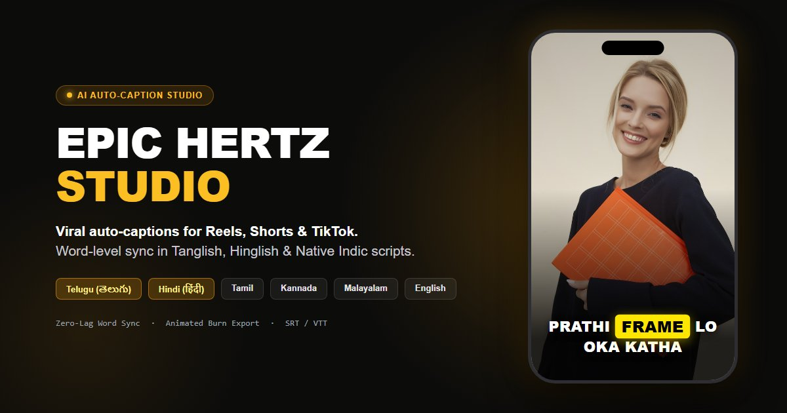

# ⚡ EPIC HERTZ STUDIO

A high-performance, AI-powered auto-captioning and kinetic subtitle studio designed for Creators, Reels, TikTok, and YouTube Shorts.

<p align="center">
  
</p>

<p align="center">
  <a href="https://epic-hertz-studio.vercel.app/" target="_blank">
    
  </a>
  <a href="https://saikrishna-bethamcharla.github.io/Epic-Hertz-Studio/" target="_blank">
    
  </a>
  
</p>

---

## ✨ Features

### 🌌 3D Scroll-Craft Landing Experience
- **Dimensional 3D Hero:** Multi-plane parallax responding dynamically to cursor position.
- **"Raw vs. Viral" Split-Scrub Curtain:** Interactive before-and-after slider comparing raw footage with kinetic captioned video in real time.
- **Horizontal Reel Runway:** 9:16 vertical smartphone previews showcasing trending creator typography and karaoke sync.
- **HTML5 Canvas Soundwave Sculptor:** Real-time multi-harmonic audio waveform canvas with reactive frequency spectrum bars.
- **1-Click Demo Launcher:** Instant test drive with browser-generated demo reels without requiring an immediate file upload.

### 🌐 Multilingual & Transliteration Engine
- **Languages:** Telugu, Hindi, English, Tamil, Kannada, Malayalam, Marathi, Bengali, Spanish, French, and Auto-Detect.
- **Dual Script Modes:**
  - **Romanized (Tanglish / Hinglish / Manglish):** Conversational regional speech transcribed in Latin letters for high retention.
  - **Native Indic Scripts:** Pure rendering for regional typography (తెలుగు లిపి, हिन्दी, தமிழ், etc.).

### 🎨 Caption Engine & Style Library
One Canvas 2D engine (`src/subtitle-tool/engine/`) renders the live preview, the gallery thumbnails **and** the exported video, so the export always matches what you see.

- **15 original presets** in four groups: *Viral* (Pulse, Block, Slam, Comic), *Kinetic* (Stack, Karaoke, Typed, Glitch), *Glow & colour* (Neon, Ember, Gilt) and *Film & clean* (Cinema, Broadcast, Pill, Minimal). Gallery thumbnails animate on hover and use **your own captions**.
- **Real typography:** self-hosted open-source fonts (Montserrat, Poppins, Inter, Anton, Bebas Neue, Oswald, Archivo Black, Playfair Display, Bangers) plus Noto Sans for Telugu, Devanagari, Tamil, Kannada, Malayalam and Bengali, loaded on demand. See `public/fonts/OFL-NOTICE.md`.
- **Motion:** spring and eased entrances (pop, slide, zoom slam, blur, mask reveal, drop, typewriter, glitch), exits, per-line / per-word / per-letter stagger, bounce and tilt.
- **Highlighting the spoken word:** colour, a box that glides between words, underline, or a karaoke colour sweep, with optional pop scale and dimmed upcoming words.
- **Treatments:** gradient fills, outline, soft shadow, glow, 3-D extrusion, and block or per-line background plates.
- **Indic-script aware:** conjuncts are shaped correctly; those scripts are never split into letters or tracked out, and get extra line height.
- **Direct manipulation:** drag the captions in the preview (snaps to centre lines), or use the position controls.

### 🎬 Pro 3-Column Studio Editor
- **Caption Editor:** Word-level timestamp precision, split/merge segments, inline search, and hotkeys.
- **Center Reel Player:** 60fps `requestAnimationFrame` sync loop, `-0.35s` timing lead offset to eliminate vocal lag, and safe-zone overlays for Instagram Reels, TikTok, and YouTube Shorts.
- **Multi-Track Timeline:** Waveform visualizer, zoom, split, trim, and scrub playhead.
- **Style panel:** a live preset gallery plus a Customize tab (text, colour, highlight, effects, motion, position & timing).
- **Responsive:** on phones the editor switches to a preview-on-top layout with Captions / Styles / Timeline tabs.

### ⚡ Zero-Config Export
- **Lossless Subtitles:** Download industry-standard `.srt`, `.vtt`, or clean `.txt` transcripts.
- **Animated burn-in (default):** the caption engine draws every frame of your video, so animation, highlights and fonts are baked in exactly as previewed. It uses WebCodecs (via [Mediabunny](https://mediabunny.dev)): the source is decoded frame by frame, captions are drawn on top, and the result is hardware-encoded to H.264 MP4 with the original frame rate and audio kept. Choose Standard / High / Maximum quality and Original / up to 1080p size. It is not tied to playback, so it can run faster than real time on devices with hardware encoders.
  - **Automatic fallbacks:** if the browser can't do this (no WebCodecs, or audio that can't be carried over), export falls back to a real-time canvas recording, and finally to static FFmpeg hard-subs. A file is never produced silently without its sound.
- **Soft subtitles:** lossless MP4 with a subtitle track.

---

## 🛠️ Tech Stack

<div align="center">
  
</div>

<br/>

- **Framework:** React 18, TypeScript, Vite 6
- **Styling:** Tailwind CSS 4
- **Motion & Interactions:** Framer Motion 11
- **Media Processing:** Web Audio API, Canvas 2D, FFmpeg WebAssembly (`@ffmpeg/ffmpeg`)
- **AI Speech-to-Text:** Google Gemini API via Vercel Serverless proxy (`/api/transcribe`)

---

## 🚀 Running Locally

### Prerequisites
- Node.js 20+ (Node.js 22+ recommended)
- npm 10+

### Setup

```bash
# Clone the repository
git clone https://github.com/saikrishna-bethamcharla/Epic-Hertz-Studio.git
cd Epic-Hertz-Studio

# Install dependencies
npm install

# Start development server
npm run dev
```

Open [http://localhost:5173/?view=studio](http://localhost:5173/?view=studio) in your browser.

> **Tip:** Append `?view=studio` to the local URL to force-load the Epic Hertz Studio interface in local development environments.

### Transcription API (local)

`npm run dev` serves only the front end. To exercise `/api/transcribe` locally, run `npx vercel dev` with a `.env.local` copied from `.env.example`.

### Production Build

```bash
npm run build
npm run preview
```

---

## 📦 Third-party notices

- **Mediabunny** (export pipeline): MPL-2.0. Used unmodified as a dependency.
- **Fonts** in `public/fonts/`: SIL Open Font License 1.1 (see `public/fonts/OFL-NOTICE.md`).

---

## 🔐 Deployment & Environment

| Variable | Required | Purpose |
| --- | --- | --- |
| `GEMINI_API_KEY` | yes | Server-side Gemini key. **Never** prefix it with `VITE_` (Vite would publish it in the JS bundle). |
| `ALLOWED_ORIGINS` | no | Comma-separated origins allowed to call the API (defaults: production, GitHub Pages, localhost). Add preview URLs here. |
| `UPSTASH_REDIS_REST_URL` / `_TOKEN` | recommended | Shared rate-limit store. Without it, limits apply per serverless instance only. |
| `RATE_LIMIT_PER_MIN` / `RATE_LIMIT_PER_DAY` | no | Per-IP request limits (defaults 8 / 60). One request ≈ 2 minutes of audio. |
| `MAX_AUDIO_BYTES` | no | Per-request audio cap (default 4.4 MB, just under Vercel's body limit). |
| `GEMINI_MODELS` | no | Comma-separated model fallback order. |

**How long videos work:** the browser extracts 16 kHz mono audio, splits it at the quietest moment near every ~100 s, sends the pieces two at a time, then stitches the captions back onto one timeline. Rate-limit and overload responses are retried automatically.

**One codebase, two sites:** `src/App.tsx` picks the Studio or the portfolio from the hostname/path (see `isStudioApp`). Each is its own lazy-loaded chunk. Use `?view=studio` or `?view=portfolio` to force one locally.

---

## 🏗️ Project Architecture

```
Epic-Hertz-Studio/
├── api/
│   ├── transcribe.js             # Vercel serverless proxy: origin allowlist, rate limit, size cap, Gemini call
│   └── _lib/parse.js             # Caption JSON/SRT parsing & timestamp normalisation (not deployed as an endpoint)
├── public/                       # Static assets & FFmpeg WASM binaries
├── src/
│   ├── App.tsx                   # Hostname routing; lazy-loads Studio or Portfolio
│   ├── PortfolioApp.tsx          # The portfolio experience
│   ├── main.tsx                  # Application mount
│   ├── index.css                 # Tailwind 4 design system
│   ├── subtitle-tool/
│   │   ├── SubtitleTool.tsx      # Main Studio lifecycle controller
│   │   ├── LandingScrollCraft.tsx# 3D Scroll-Craft interactive landing showcase
│   │   ├── VideoPreview.tsx      # 60fps reel player with safe-zone overlays
│   │   ├── CaptionEditor.tsx     # Left-side transcript & segment editor
│   │   ├── TemplateDrawer.tsx    # Right-side viral preset & style palette
│   │   ├── Timeline.tsx          # Multi-track audio waveform timeline
│   │   ├── PrepareMediaModal.tsx # Pre-processing language & script selector
│   │   ├── ExportModal.tsx       # Export options (SRT, VTT, TXT, Hardsub MP4)
│   │   ├── api/
│   │   │   └── transcribe.ts     # Chunked upload, retries, timeline stitching
│   │   ├── engine/               # Caption engine: render.ts, presets.ts, spec.ts, fonts.ts, util.ts, compat.ts
│   │   ├── CaptionCanvas.tsx     # Preview overlay: follows the video rect, drag-to-position
│   │   └── utils/
│   │       ├── burnCaptions.ts   # Canvas / FFmpeg video burn pipeline
│   │       ├── extractAudio.ts   # Client-side audio track extractor (always 16 kHz mono WAV)
│   │       ├── splitAudio.ts     # Silence-aware chunking + timeline merge
│   │       └── srt.ts            # Subtitle format serializers
```

---

## 📄 License

MIT © [Sai Krishna Bethamcharla](https://github.com/saikrishna-bethamcharla)
